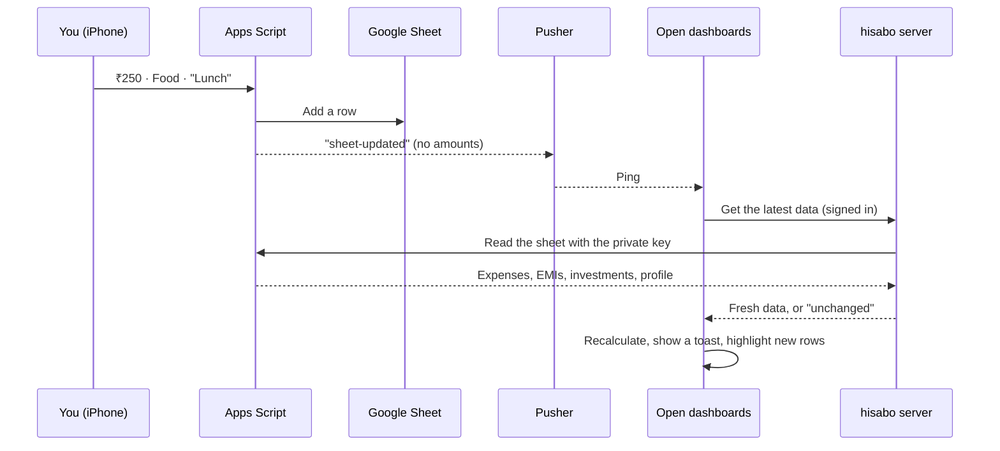

# hisabo.

**Har rupaye ka hisaab.** *(An account of every rupee.)*

hisabo is a private, live expense dashboard built on a Google Sheet. You log spending from your iPhone in a few taps, the entry lands in a sheet you own, and every open dashboard, on your laptop or your phone, updates on its own a few seconds later.

It tracks day-to-day expenses, EMIs and investments, and turns them into totals, charts, budgets and insights.

**Built with:** Next.js 16 · React 19 · TypeScript · Tailwind CSS 4 · shadcn/ui · Recharts · Google Apps Script · Pusher

---

## How it works



### 1. You log it

You can log an entry in two ways:

- **From the iPhone Shortcut.** Run it from the home screen, a widget or Siri. Enter the amount, pick a category and add a note if you like. The Shortcut sends it straight to your sheet's web app.
- **From the dashboard.** Use **Add expense**, **Add investment** or **Add EMI**, or the round **+** button on a phone. You choose the date and time the spending happened, so you can backfill last week. Future dates are refused.

### 2. Your sheet stores it

A small Apps Script, attached to your Google Sheet and published as a web app, checks each entry. It needs a positive amount, a category or type, and a valid date. It then adds a row to the right tab: **Expenses**, **EMI** or **Investments**, creating the tab the first time.

The sheet is the only database. Nothing is copied to another server. Reading the data back needs a private dashboard key, so the web app link on its own doesn't reveal your spending.

### 3. Open dashboards hear about it

Right after saving, the script sends a tiny "sheet-updated" ping through Pusher. The ping says only that something changed: no amounts, no notes, no categories. Editing the sheet by hand sends the same ping, so a fixed typo shows up too.

### 4. Each dashboard fetches and redraws

When the ping arrives, every open dashboard asks the hisabo server for the latest data:

1. The server checks that you're signed in.
2. It reads the sheet through Apps Script using the private key, which never leaves the server.
3. It sends back the data, or a short "unchanged" reply if nothing is new.
4. The dashboard recalculates totals, charts, budget pace and insights. It also shows a toast for each new expense and highlights the new rows.

Phones pause pages in the background, so the dashboard also checks once whenever you come back to it. If live updates aren't set up, it still works; it just refreshes when you open it.

### Signing in

The dashboard sits behind a username and password. Anyone who isn't signed in is sent to the login page. Signing in sets a signed, browser-protected cookie that lasts 30 days. Changing the username or password signs every device out.

---

## Why hisabo

- **You own the data.** Everything lives in a Google Sheet in your own Drive. Sort it, chart it, fix a row or export it whenever you like. There's no separate database to trust or migrate away from.
- **Logging takes seconds.** The Shortcut is a few taps from the home screen or a single Siri phrase. You log at the counter instead of piecing the day together later.
- **Live, without polling.** No timer reloads the page every few seconds. Dashboards fetch only when something actually changes, which keeps them fast and well inside free limits.
- **Free to run.** For one person, Google Sheets and Apps Script are free, and so are the free plans of Pusher and Vercel.
- **Private by design.** The sheet link, keys and password stay on the server and never reach the browser. Live pings carry no data. An eye button hides every amount (₹ ••••) when you're using it in public.
- **Edit in either place.** Change a row in the sheet and the dashboard follows. Add from the dashboard and it lands in the sheet.
- **Made for desktop and phone.** On desktop there's a collapsible sidebar; on a phone, a bottom tab bar. Add it to the home screen and it opens full screen like an app.
- **Easy to try.** With no sheet connected, it runs on built-in demo data.
- **Safe to update.** Updating the script keeps the same web app link, so your Shortcut keeps working.

---

## What you'll see

- **Overview:** a personal greeting, total spent with a running-total chart against the previous period, a budget ring, KPI cards with trends, a category donut, auto-generated insights, recent expenses and upcoming EMIs.
- **Analytics:** each category's change against the previous period, top places, spending by weekday and time of day, 12 months by category, and a calendar heatmap of every day.
- **Transactions:** search by place, note or category, filter by category, sort and export to CSV. It shows a table on desktop and a list grouped by day on phones.
- **Subscriptions:** what your subscriptions cost per month and per year, the next renewal date of each (worked out from the billing frequency), ones with auto-renew off, one-time payments, and every payment. Subscription payments also count in your spending, under the Subscriptions category.
- **Investments:** total invested, this month against the same days last month, your monthly commitment, money invested per month by type, allocation, and a card for each recurring plan (SIPs and the like) with its platform and next expected date.
- **EMIs:** monthly outflow, amount left, the date you'll be EMI-free, a 12-month outlook, a card for each EMI and your recorded payments. When you record payments (or enter instalments already paid), hisabo counts those; otherwise it assumes one instalment a month from the start date.
- **Profile:** your name, plus optional email, monthly income (shows "% of income spent"), monthly budget (drives the budget ring) and payday (a "Payday in N days" countdown). It's saved in your sheet, so it's the same on every device.

The dashboard opens in a dark green theme, and a toggle switches it to light mode.

### What the Shortcut sends

The Shortcut asks for the amount, then what it is (Expense, Subscription, Investment or EMI), then only the questions that type needs. It posts a small JSON body to your web app link:

```json
{ "Type": "Expense", "Amount": 250, "Category": "Food & Dining", "Date": "2026-10-31T13:05:00+05:30", "PaymentMethod": "UPI (Credit Card)", "CardName": "Kotak CC", "Remark": "Lunch" }
```

| Entry | Fields |
|---|---|
| Expense (default) | `Amount`, `Category`, optional `Merchant`, `Date`, `PaymentMethod`, `CardName`, `Remark` |
| Subscription | `Type: "Subscription"`, `Amount`, `Name`, `Frequency` (`Weekly`, `Monthly`, `Quarterly`, `Yearly` or `One-time`), `AutoRenew` (`Yes`/`No`), optional `Date`, `PaymentMethod`, `CardName`, `Remark` |
| Investment | `Type: "Investment"`, `Amount`, `InvestmentType` (e.g. Mutual Fund, PPF), optional `InvestmentName`, `Frequency` (`One-Time`, `Weekly`, `Monthly`, `Quarterly` or `Yearly`), `Platform`, `Date`, `PaymentMethod`, `CardName`, `Remark` |
| New EMI | `Type: "EMI"`, `Amount` (monthly), `Tenure` (months), `EMIName`, `StartDate`, optional `EMIType`, `PaidBefore` (instalments already paid), `PaymentMethod`, `CardName`, `Remark` |
| EMI payment | `Type: "EMIPayment"`, `Amount`, `EMIName` (an EMI you've already added), optional `Date`, `PaymentMethod`, `CardName`, `Remark` |

Without a `Date`, an entry is saved at the current time; dates in the future are refused. Recurring investments with the same type and name are grouped into one plan. EMI start dates can be a real date or text such as `05/03/2026` or `5 Mar 2026`. Text dates are read day first. Your sheet gets **Subscriptions** and **EMI Payments** tabs, and new columns at the end of the others, the first time they're needed.

---

## Run it locally

### What you need

- [Node.js](https://nodejs.org) 20.9 or newer (includes npm)
- [Git](https://git-scm.com)
- For your own data: a Google account. For live updates: a free [Pusher](https://pusher.com) account. You need neither to try it with demo data.

### 1. Clone and install

```bash
git clone https://github.com/gpradhan07/hisabo.git
cd hisabo
npm install
```

### 2. Add your settings

Copy the settings template:

```bash
cp .env.example .env.local
```

Open `.env.local` and fill in at least the sign-in details:

| Setting | What to put |
|---|---|
| `DASHBOARD_USERNAME` | Any username |
| `DASHBOARD_PASSWORD` | A password of 8 or more characters |
| `SESSION_SECRET` | A random string. Generate one with the command below. |

```bash
node -e "console.log(require('crypto').randomBytes(32).toString('base64url'))"
```

You can leave everything else empty for now. Without a sheet link the dashboard shows demo data, and without Pusher keys it refreshes when you open it. The Firebase and Google settings are for the upcoming hosted version, so leave them empty too.

`.env.local` is ignored by git, so your keys are never committed.

### 3. Start it

```bash
npm run dev
```

Open http://localhost:3000 and sign in with the username and password you chose.

**To open it on your phone over the same Wi-Fi**, run `npm run dev:phone` instead. Then visit `http://<your-computer's-IP>:3000` on the phone. On a Mac, `ipconfig getifaddr en0` prints the IP.

### 4. Connect your Google Sheet (optional)

1. Open your Google Sheet and go to **Extensions → Apps Script**. Replace the code there with the script in this repo's `apps-script` folder, then save.
2. In the toolbar, pick **`setupDashboardKey`** and click **Run**. Copy the key from the Execution log into `DASHBOARD_KEY`.
3. Go to **Deploy → New deployment**, choose **Web app**, set **Execute as: Me** and **Who has access: Anyone**, then click **Deploy**. Copy the URL that ends in `/exec` into `APPS_SCRIPT_URL`.
4. **Live updates:** create a free app at [dashboard.pusher.com](https://dashboard.pusher.com) (Channels → Create app). From its **App Keys** tab, paste `app_id`, `key`, `secret` and `cluster` into `setupLiveUpdates()` at the bottom of the script. Then run **`setupLiveUpdates`** and allow the permissions it asks for. Copy the three `PUSHER_…` lines it prints into `.env.local`. The Pusher secret stays in Apps Script; the dashboard never needs it.
5. Point your iPhone Shortcut's **Get Contents of URL** action at the same `/exec` URL, with method **POST** and a JSON body (see [What the Shortcut sends](#what-the-shortcut-sends)).
6. Stop the dev server and run `npm run dev` again so it picks up the new settings.

Whenever you change the script later, use **Deploy → Manage deployments → ✏️ Edit → Version: New version → Deploy**. Editing the existing deployment keeps the same URL, so the Shortcut doesn't need changing.

### 5. Use it on your iPhone (deploy)

Vercel is free for personal projects:

1. Push your copy of the repo to GitHub.
2. Import it at [vercel.com/new](https://vercel.com/new).
3. Under **Settings → Environment Variables**, add the same settings you have in `.env.local`. A deployed copy refuses the placeholder password `change-me` and any password shorter than 8 characters.
4. Open the Vercel URL in Safari and tap **Share → Add to Home Screen**.

### Commands

| Command | What it does |
|---|---|
| `npm run dev` | Starts the app at http://localhost:3000 |
| `npm run dev:phone` | Same, and also reachable from other devices on your Wi-Fi |
| `npm run build` | Builds the production version |
| `npm start` | Serves the production build |
| `npm run lint` | Checks the code style |
| `npm run typecheck` | Checks the TypeScript types |
